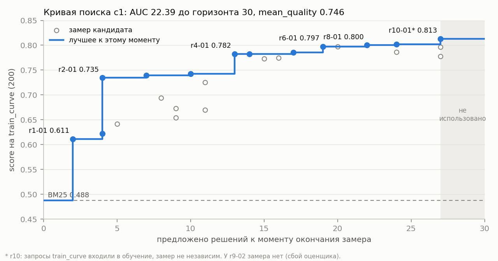
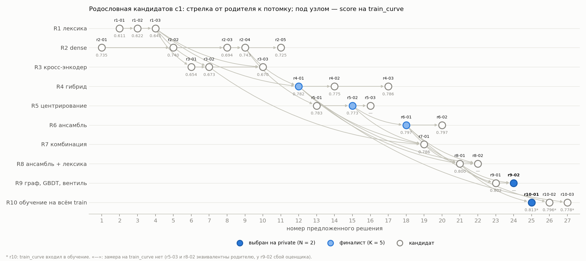
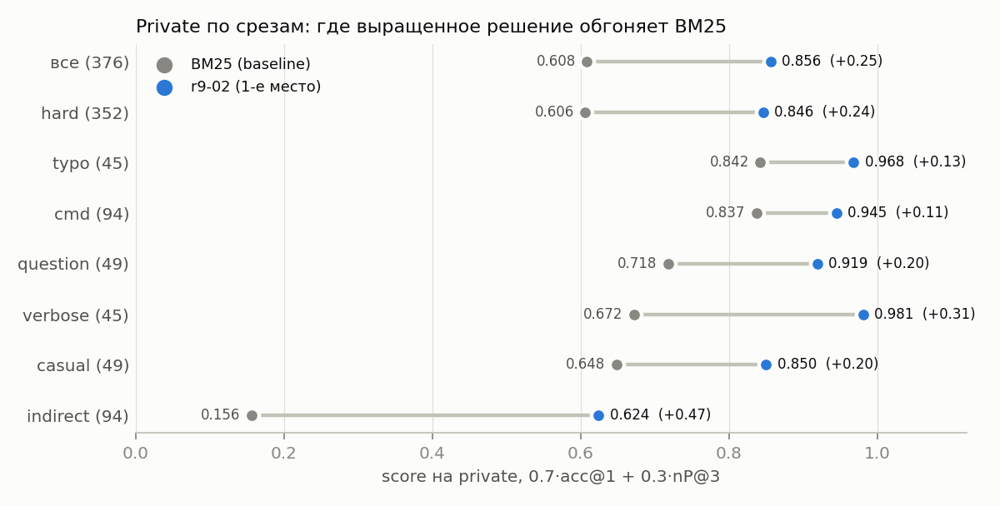

# Разбор эволюции: кампания c1

Кампания AR-04а на арене DeepPavlov `a28eee3`, 5–6 ноября 2026. Модель исследователей — Claude Sonnet 5.5 (effort high), все 2 614 ответов агентов сделаны ею. Всё, на что ссылается текст, лежит в [results/campaign-1/](../results/campaign-1/README.md): журнал, кривая, снимки кандидатов, транскрипты агентов. Записи самих агентов: [campaign.md](../case/campaigns/c1/campaign.md), [findings](../case/campaigns/c1/board/findings/), [ревью](../case/campaigns/c1/board/reviews/), [selection.md](../case/campaigns/c1/selection.md).

## Итог в цифрах
| | `train_curve` (200) | public (380) | private (376) |
|---|---|---|---|
| BM25 (baseline) | 0.488 | 0.537 | 0.608 |
| **r9-02** (1-е место на private) | — ¹ | 0.8225 | **0.856** |
| r10-01 (2-е место) | 0.813 ² | 0.8267 | 0.853 |

Метрика `0.7·acc@1 + 0.3·nP@3` ([ADR-0003](adr/0003-metric.md)).

- **Масштаб.** Предложено 27 решений из 30 по 10 направлениям. Работали 10 субагентов-исследователей и 4 ревьюера. Поиск остановлен командой оператора на плато.
- **Время.** Активный поиск занял около 9 ч, ещё около 1.3 ч ушло на private.
- **Токены агентов поиска.** 0.95 млн выходных токенов и 4.75 млн входных без кэша; это в пределах оценки 3–9 млн из [ADR-0005](adr/0005-campaign-limit.md). Ещё 160 млн входных токенов агенты прочитали из кэша.

¹ Замер сорван инфраструктурным сбоем, см. «Процесс».
² Запросы `train_curve` входили в обучение r10-01, поэтому это не независимая проверка.

## Кривая и AUC


Кривая строится штатной командой арены `evaluator.search curve` ([curve.json](../results/campaign-1/curve.json)). По оси X — сколько решений было предложено к моменту окончания замера, по оси Y — лучший score на `train_curve` к этому моменту.

- **AUC до горизонта 30 — 22.39, `mean_quality` 0.746.** Последнее значение арена продлевает до горизонта, поэтому три неиспользованных места AUC не уменьшают.
- **Рост дали три скачка за первые 13 решений:**
  - лексика, BM25 0.488 → 0.611 (r1-01, 2-е решение);
  - dense-энкодер, → 0.735 (r2-01, 4-е);
  - гибрид лексики и dense, → 0.783 (r4-01, 13-е).
- **Дальше плато:** 0.797 (r6-01), 0.800 (r8-01), 0.802 (r9-01), 0.813 (r10-01). Каждая из этих ступеней меньше шума: на 200 запросах стандартная ошибка около 3 п.п.
- **Ступень r10-01 нечестная:** этот кандидат учился на запросах `train_curve`. Без него итог кривой 0.802, AUC 22.36, то есть AUC почти не меняется.
- **Почему AUC не выше.** Первые два направления шли параллельно, и dense-кандидат r2-01 закончил замер только к 4-му предложенному решению. Резервы есть, но небольшие: раньше начать гибрид и не регистрировать дубли (см. «Процесс»).

## Родословная


Родословная записана в журнале арены ([journal.json](../results/campaign-1/journal.json), поле `parents`). Корней два: лексика (r1-01) и dense (r2-01). Остальное — их скрещивания и надстройки:

```
r1-01 → r1-02 → r1-03 ─────────────┐
r2-01 → r2-02 → r2-04 ─────────────┴→ r4-01 (гибрид) ─────────────┐
                r2-04 → r5-01 → r5-02 (центрирование) → r6-01 (ансамбль) ─┴→ r8-01 → r9-01 ─┐
                                                                    r8-01 ────────────────────┴→ r9-02 ✓
                                                                    r8-01 → r10-01 ✓ (обучение на всём train)
```

Путь к победителю r9-02 проходит через все удачные механизмы: нормализованную лексику, dense-энкодер, центрирование, ансамбль энкодеров и гибрид. Тупиковые ветки — кросс-энкодер (R3) и меньшая модель (r2-03). У направлений R1–R5 ветка шла цепочкой: каждая версия исправляла предыдущую. Начиная с R6, оркестратор строил кандидатов скрещиванием лучших механизмов.

## Ключевые мутации
Δ — изменение на `train_curve` относительно родителя. Все замеры до R10 независимы: кандидаты обучались на 556 записях train, а все 50 семейств `train_curve` из обучения исключены.

| Кандидат | Родитель | Гипотеза | Изменение | Δ score | Почему сработало / нет |
|---|---|---|---|---|---|
| r1-01 | BM25 | Лексике не хватает нормализации слов | Стоп-слова, стеммер Портера, k1 = 1.2 | **+0.123** (→ 0.611) | Baseline сравнивал слова без нормализации. Это главный выигрыш лексики |
| r1-03 | r1-02 | Опечатки и частичные совпадения | Исправление опечаток по словарю каталога (r1-02) и косинус символьных триграмм | +0.031 (→ 0.642) | typo: 0.695 → 0.798. Потолок лексики около 0.69: в 64 из 139 indirect-запросов fit нет ни одного общего слова с описанием |
| r2-01 | — | Семантика закроет косвенные запросы | bge-base: эмбеддинги каталога в build, numpy-реализация BERT в solve | **+0.093** к r1-03 (→ 0.735) | indirect acc@1: 0.11 у BM25 → 0.56. numpy-энкодер совпадает с torch до 1e-7, а solve в r2-02 ускорен с 3.6 до 1.6 с на запрос |
| r4-01 | r1-03, r2-04 | Лексика и dense ошибаются по-разному | Гибрид; метод слияния (взвешенная сумма z-оценок, RRF, логрегрессия) выбирается групповой CV в build | **+0.040** к r2-04 (→ 0.783) | typo +19 п.п., verbose +18 п.п. RRF хуже взвешенной суммы на 2–3 п.п. CV в build предсказала +3.9 п.п., на `train_curve` вышло +4.0 |
| r5-01, r5-02 | r2-04 | Представление можно дообучить на train | Центрирование: вычесть средний вектор запросов и каталога; в r5-01 ещё линейный адаптер | +0.040 / **+0.030** | Почти весь эффект даёт центрирование (+2.4 п.п. по CV), адаптер добавляет +0.3 п.п., это шум |
| r6-01 | r5-02 | Разные энкодеры ошибаются по-разному | Ансамбль bge-base, e5-small, MiniLM (веса 2:1:1) с центрированием | **+0.025** (→ 0.797) | Рост на typo, verbose и question. indirect не растёт |
| r8-01 | r6-01, r4-01, r7-01 | Выигрыши ансамбля и лексики сложатся | Лексика поверх ансамбля, вес 0.1 | +0.003 (→ 0.800) | Не сложились: ансамбль уже исправил те же ошибки. На indirect лексика вредит (CV 0.699 → 0.652) |
| r9-02 | r8-01, r9-01 | Вес лексики должен зависеть от запроса | `w(q) = wmax·σ((tpk − c)/s)`, где `tpk` — максимальный косинус триграмм запроса с описаниями каталога | замера нет; CV +0.8…+1.2 п.п. к r8-01 | Если у запроса нет похожих слов в каталоге (`tpk` < 0.25), лексика выключается, и ответ даёт чистый ансамбль. Лучший на private: 0.856 |
| r10-01 | r8-01 | Больше данных для обучения слияния | Обучение на всех 756 записях train; build сменил метод слияния на логрегрессию | 0.813² | Public +0.4 п.п. к r8-01 — в шуме |

## Тупики
- **Кросс-энкодер (R3, R7).**
  - Над лексикой ms-marco-MiniLM и bge-reranker дали +0.01…+0.03 при 11–16 с на запрос. Dense за 2 с давал +0.10.
  - Поверх гибрида кросс-энкодер ухудшил CV: 0.8147 → 0.8059.
  - Причина: модели ms-marco обучены на веб-поиске и не различают близкие короткие описания каталога. Даже внутри топ-20 кросс-энкодер находит верный навык только в 75% случаев. Об этом риске предупреждал ToolRet ([domain.md](domain.md), п. 3 выводов).
- **Более лёгкая модель (r2-03).** bge-small вместо bge-base: −4.5 п.п.
- **Варианты текста документа и префикса запроса (r2-04, r2-05).** Разница меньше шума.
- **Обучаемые матрицы.** Адаптер запроса (r4-03, r5-01) и отбеливание (r5-03) на 556 запросах не переносятся на новые навыки. Сильное отбеливание проваливает CV до 0.56–0.67, потому что усиливает шумовые направления: 745 векторов на 768 измерений — слишком мало, чтобы оценить ковариацию.
- **Дообучение энкодера** не укладывается в лимит 600 с. Шаг на 32 запросах занимает 12 с, эпоха — около 3.7 мин.
- **Граф навыков, псевдо-релевантная обратная связь, GBDT (r9-01).** CV +0.0…+0.8 п.п., в шуме. Граф помогает определить кластер близких навыков, но не выбрать нужный навык внутри кластера.
- **Пустые мутации.**
  - Другой режим слияния (r6-02) и «затворы» лексики (r8-02): build выбрал ту же конфигурацию, ответы идентичны родителю.
  - Отбеливание (r5-03): build вернулся к конфигурации родителя.
  - Обучение r6-01 на всём train (r10-02): ответы совпали с r6-01 в 200 из 200 случаев.
- **Предел имеющихся сигналов.** В 20 запросах `train_curve` нужного навыка нет в топ-3 ни у одного варианта. Нелинейное слияние ничего не меняет: сигнала нет ни в одном признаке. Все такие запросы — косвенные.

## Сопоставление с доменом
В [domain.md](domain.md) я ожидал, что арена переоткроет гибрид BM25 и dense (через RRF или взвешенную сумму), затем переранжирование топ-N и подбор весов на train. Фактически:

1. **Гибрид арена переоткрыла (r4-01).** Сама нашла и то, что обученная взвешенная сумма нормированных score лучше RRF на 2–3 п.п. Тот же вывод есть у Bruch и др. [3]: выпуклая комбинация обгоняет RRF и настраивается на малом числе примеров.
2. **Переранжирование не сработало.** Причина — несовпадение домена у моделей ms-marco, как и предупреждал ToolRet.
3. **Веса на train подобрали, но главным обучаемым элементом оказалось самое простое — средний вектор запросов.** Центрирование давало +3 п.п. Это классический приём борьбы с анизотропией эмбеддингов: удалить общий средний вектор [1]. Отбеливание [2], следующий шаг той же идеи, у нас проиграло из-за малого числа запросов.
4. **Не было в моём списке:**
   - **Ансамбль трёх энкодеров.** Дёшево по времени: solve почти не медленнее одной модели.
   - **Вес лексики, зависящий от запроса** (вентиль в r9-02). Это вариант слияния, которое учитывает сам запрос. Лексике доверяем, только если у запроса вообще есть словесное пересечение с каталогом.
5. **LTR (GBDT, lambdarank) пробовали, выигрыша нет.** Признаков и данных слишком мало: три параметра вентиля дают то же, что 80 деревьев.

**Инженерная находка агентов.** Своя numpy-реализация BERT-энкодера и кросс-энкодера, совпадающая с torch до 1e-6. Импорт torch в каждом процессе стоил около 4 с ([results/models/bench.md](../results/models/bench.md)). Без этой реализации dense-кандидаты были бы в 2–3 раза медленнее, а кросс-энкодер — в 5–8 раз дороже.

## Вклад компонентов
**Абляция на `train_curve`.** Все шаги ниже — независимые замеры кандидатов, обученных на 556 записях:

| Шаг | Кандидат | `train_curve` | Δ |
|---|---|---|---|
| BM25 | baseline | 0.488 | |
| нормализованная лексика | r1-03 | 0.642 | +0.154 |
| dense bge-base вместо лексики | r2-04 | 0.743 | +0.101 к r1-03 |
| dense + лексика (гибрид) | r4-01 | 0.783 | +0.040 к r2-04 |
| dense + центрирование | r5-02 | 0.773 | +0.030 к r2-04 |
| гибрид + центрирование | r7-01 | 0.787 | +0.004 к r4-01 |
| ансамбль из трёх энкодеров с центрированием | r6-01 | 0.797 | +0.025 к r5-02 |
| ансамбль + лексика | r8-01 | 0.800 | +0.003 к r6-01 |

**Абляция на private.** Финалисты специально выбраны разными по механизму, поэтому на private они дают абляцию по двум осям. Она приблизительная: в r4-01 нет центрирования.

| | без лексики | с лексикой |
|---|---|---|
| один bge-base | r5-02: 0.810 | r4-01: 0.843 |
| ансамбль трёх энкодеров | r6-01: 0.840 | r10-01: 0.853 (постоянный вес), r9-02: 0.856 (вентиль) |

- **Компоненты перекрываются.** С одним энкодером лексика добавляет 3.3 п.п., с ансамблем — 1.3–1.6. Ансамбль без лексики добавляет 3.0 п.п., с лексикой — 1.0–1.3. Механизмы чинят частично одни и те же ошибки.
- **Лексика помогает и вредит одновременно** ([private по срезам](../results/campaign-1/private/slices.md)):
  - на `cmd`, `typo` и `casual` она поднимает ансамбль на 3–5 п.п.;
  - на `indirect` лучший — ансамбль без лексики: r6-01 0.639 против 0.610 у r10-01;
  - вентиль r9-02 (0.624) забирает обе стороны частично.

  Разницы 1–3 п.п. на private на грани шума (около ±2.5 п.п.). Но направление совпадает на CV, public и private.



## Переобучение
| Кандидат | Train (`train_curve`) | Public | Private | Убрано ошибок BM25 (curve / public / private) |
|---|---|---|---|---|
| r9-02 | — | 0.8225 | 0.856 | — / 0.62 / 0.63 |
| r10-01 | 0.813² | 0.8267 | 0.853 | 0.64 / 0.63 / 0.63 |
| r4-01 | 0.783 | 0.781 | 0.843 | 0.58 / 0.53 / 0.60 |
| r6-01 | 0.797 | 0.805 | 0.840 | 0.60 / 0.58 / 0.59 |
| r5-02 | 0.773 | 0.760 | 0.810 | 0.56 / 0.48 / 0.51 |
| r8-01 | 0.800 | 0.823 | — | 0.61 / 0.62 / — |
| r9-01 | 0.802 | 0.806 | — | 0.61 / 0.58 / — |
| r2-02 | 0.740 | 0.743 | — | 0.49 / 0.44 / — |
| r1-03 | 0.642 | 0.679 | — | 0.30 / 0.31 / — |

Доля убранных ошибок считается как `(score − BM25) / (1 − BM25)` на той же выборке.

- **Переобучения не видно.** Порядок финалистов почти сохранился: r9-02 и r10-01, а также r6-01 и r4-01 поменялись местами в пределах шума, r5-02 последний везде. Public у ансамблевых кандидатов даже чуть выше `train_curve`.
- **Private легче остальных выборок.** Так вышло случайно при делении по семействам: BM25 там 0.608 против 0.537 на public. Поэтому абсолютный score на private у всех выше, а отрыв от BM25 ниже, чем на `train_curve`: +0.23–0.25 против +0.29–0.31.
- **Стабильная мера — доля убранных ошибок BM25.** У лучших кандидатов она держится около 0.6 на всех трёх выборках: решение убирает примерно 60% ошибок BM25 независимо от выборки.
- **CV в build согласуется с `train_curve`.** R4 по CV предсказал +3.9 п.п., получилось +4.0. R5 предсказал +2.8, получилось +4.0. Групповая CV по семействам честно имитирует новые навыки.
- **Остаточный риск — выбор по `train_curve`.** Его видели все исследователи, и на нём сравнивали 24 кандидата. При шуме 3 п.п. выбор лучшего по нему оптимистичен. Поэтому финалистов отбирали по public, а итог дал private.

## Процесс: что пошло не по плану
- **Нарушения правил исследователями.** Правило: «локально только чистый Python, модели только в runner».
  - **R2** в начале поставил torch и запустил сравнение моделей. Оркестратор остановил прогон, окружение удалили, лог не читали.
  - **R9** поставил numpy и lightgbm. На дампе оценок из build он вне runner разработал форму вентиля для r9-02, а до регистрации r9-02 прикинул вентиль на ответах `train_curve`.
  - Нарушение R9 нашёл независимый ревьюер. В пакет из локальных расчётов ничего не попало: параметры вентиля выбирает build на fit. Но дизайн победителя получен с отступлением от протокола, а «+1.25 п.п. на 8 других разбиениях» из findings R9 по журналу не воспроизводится. Ему в плюс говорит private: r9-02 там первый.
  - Запрет держался на просьбе, а не на правах доступа. Если повторять кампанию, в контейнере исследователя стоит закрыть установку пакетов.
- **Инфраструктурные сбои:**
  - замер r9-02 на `train_curve` и public-проверку r2-04 прервало закрытие сессии оператора, повторить их оценщики не дают;
  - public r4-01 оркестратор ошибочно закрыл из-за бага в своём инструменте и перемерил как `r4-01-public2`;
  - три раза рассинхрон часов WSL дал отрицательное `judge_seconds`. Эти замеры закрыты по решению оператора: `judge_seconds 0` с пометкой о неполноте и исходным ответом в evidence.
- **Потраченные впустую места:** r5-03, r6-02, r8-02 и r10-02 — функциональные повторы родителей, 4 из 27. В R6 и R8 исследователь мог предвидеть повтор: build почти наверняка выбрал бы ту же конфигурацию.
- **Остановка на 27.** Исследователи вернули оркестратору часть мест: в R1 и R3–R9 структурных идей больше не было. После R10 оркестратор прямо написал, что на оставшиеся места идей нет. Оператор остановил поиск, и три места остались неиспользованными.
- **Public-проверок 11:** 9 успешных и 2 неудачных (баг инструмента оркестратора и прерывание), при ориентире 8–10.

## Что я понял о задаче
- **Трудность не в близких навыках, а в косвенных формулировках.** Срез `hard` (навык из кластера близких) у нас почти совпадает со всей выборкой — 352 из 376 запросов, поэтому трудность он не разделяет. Её разделяет стиль запроса: на `indirect` BM25 набирает 0.156, лучший кандидат — 0.62. Остальные стили лучший кандидат решает на 0.85–0.98.
- **Лексика и семантика — не слабый и сильный сигнал, а разные сигналы.** Лексика надёжна, когда в запросе есть название сервиса, опечатка в узнаваемом слове или длинное описание. Семантика нужна, когда общих слов нет. Правильный вес лексики зависит от запроса, и это отражает вентиль r9-02.
- **Данных мало, поэтому выигрывают методы с 1–3 обучаемыми параметрами.** На 556–756 запросах, по одному семейству на навык, обобщаются средний вектор, веса слияния и три скаляра вентиля. Матрицы 768×768, деревья и дообучение энкодера не обобщаются на новые навыки.
- **Арена быстро находит большие механизмы и не может различить мелкие.** Почти весь рост пришёлся на первые 13 решений. Дальше шаги были меньше шума на 200 запросах, и выбор между версиями держался на CV и public.
- **Следующий рычаг — более сильный семантический сигнал для `indirect`.** Это энкодер крупнее bge-base или языковая модель, и то и другое за пределами условий кампании. Остальные комбинации имеющихся сигналов арена перебрала.

## Источники
Источники обзора домена — в [domain.md](domain.md#источники). Дополнительно:
1. J. Mu, S. Bhat, P. Viswanath. *All-but-the-Top: Simple and Effective Postprocessing for Word Representations.* ICLR 2018, [arXiv:1702.01417](https://arxiv.org/abs/1702.01417).
2. J. Su, J. Cao, W. Liu, Y. Ou. *Whitening Sentence Representations for Better Semantics and Faster Retrieval.* 2021, [arXiv:2103.15316](https://arxiv.org/abs/2103.15316).
3. S. Bruch, S. Gai, A. Ingber. *An Analysis of Fusion Functions for Hybrid Retrieval.* ACM TOIS 42(1), 2024, [arXiv:2210.11934](https://arxiv.org/abs/2210.11934).
